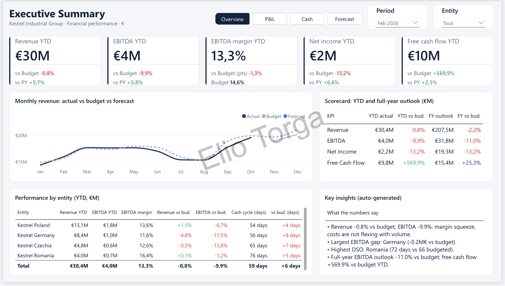
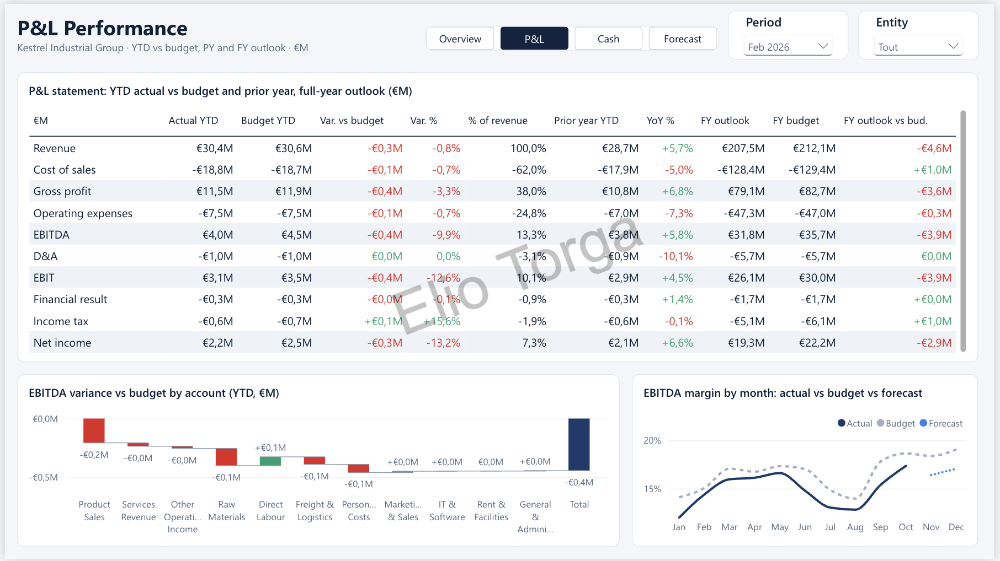
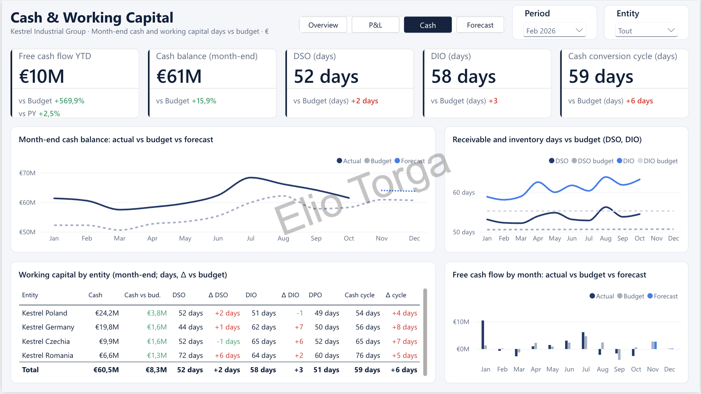
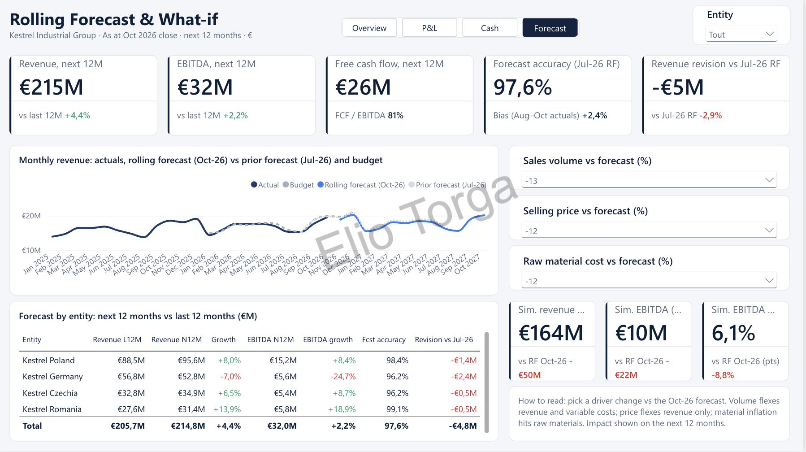
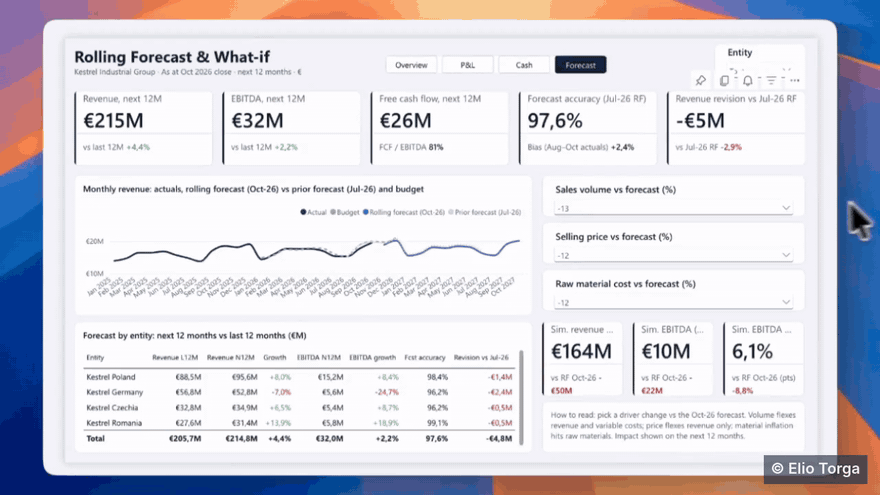
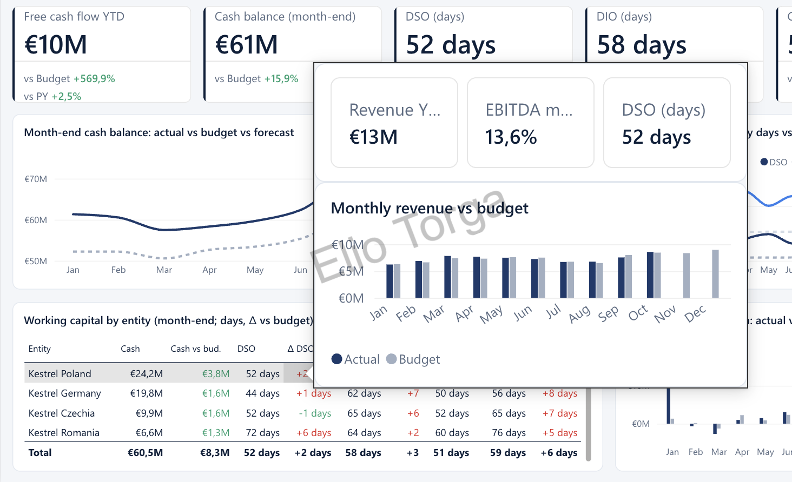

# Performance financière & Rolling Forecast – Power BI

[🇬🇧 English](README.md) · **🇫🇷 Français**

Un rapport Power BI de niveau DAF pour un groupe industriel fictif implanté en Europe centrale et orientale. Il répond aux questions qu'un directeur financier se pose chaque mois : *Sommes-nous dans le budget ? Où perdons-nous de la marge ? La trésorerie est-elle maîtrisée ? Où allons-nous atterrir, et que se passe-t-il si les conditions changent ?*




---

## Contexte métier

**Kestrel Industrial Group** (fictif) compte quatre filiales : Pologne, Allemagne, Tchéquie et Roumanie. Le rapport est arrêté **à la clôture d'octobre 2026** et compare quatre versions des mêmes chiffres :

| Scénario | Signification |
|---|---|
| **Actual** (réel) | Mois clôturés, janv. 2024 – oct. 2026 |
| **Budget** | Budgets annuels 2024–2026, validés avant chaque exercice |
| **RF Jul-26** | Rolling forecast de juillet (août 2026 – juil. 2027) |
| **RF Oct-26** | Dernier rolling forecast (nov. 2026 – oct. 2027) |

## Questions auxquelles le rapport répond

| Question | Page |
|---|---|
| Le chiffre d'affaires, l'EBITDA, le résultat net et le free cash flow sont-ils dans le budget et au-dessus de l'an dernier ? | Overview |
| Quelles lignes du compte de résultat et quelles filiales expliquent l'écart d'EBITDA ? | P&L |
| La trésorerie est-elle maîtrisée ? Les clients et les stocks immobilisent-ils du BFR ? | Cash |
| Où allons-nous atterrir, notre forecast est-il fiable, et que se passe-t-il si le volume, le prix ou le coût matière évoluent ? | Forecast |

## Principaux enseignements (cumul à fin octobre 2026)

1. **Écrasement de la marge.** Le chiffre d'affaires n'est qu'à **−1,7 %** du budget (168,4 M€), mais l'EBITDA recule de **−10,1 %** (25,2 M€). La marge d'EBITDA est de 15,0 % contre 16,4 % budgétés : les coûts ne s'ajustent pas au volume.
2. **L'Allemagne explique l'essentiel de l'écart.** Son chiffre d'affaires est à −6,0 % du budget et son EBITDA à −21,5 %. Ses stocks atteignent 78 jours contre 55 prévus.
3. **La trésorerie est en avance, pas le BFR.** La trésorerie de fin de mois atteint 61,5 M€ (+5,5 % vs budget), mais le cycle de conversion de trésorerie passe à 68 jours (+15). La Roumanie encaisse lentement : DSO de 90 jours contre 66.
4. **L'année ne sera pas rattrapée.** L'atterrissage annuel de l'EBITDA (réel + dernier forecast) est à **−11,0 %** du budget.
5. **Un forecast fiable mais optimiste.** Le forecast de juillet atteint **97,6 % de fiabilité** sur le chiffre d'affaires d'août à octobre, avec un biais optimiste de +2,4 %. Le forecast d'octobre réduit le chiffre d'affaires des 12 prochains mois d'environ 5 M€ (−2,9 %), dont près de la moitié en Allemagne.
6. **Test de résistance.** Avec un volume à −3 %, des prix à +2 % et des matières premières à +5 %, l'EBITDA des 12 prochains mois passe d'environ 32 M€ à 29 M€ et la marge de 14,9 % à 13,8 %.

## Présentation du rapport

Toutes les pages partagent le même en-tête : titre, navigation entre pages, et filtres **Période** et **Entité** synchronisés. Le vert et le rouge signifient toujours favorable et défavorable par rapport au budget, y compris pour les coûts et les délais de BFR, où une hausse est négative.

### 1. Overview
Cartes KPI (cumul vs budget et vs N-1), tendance du chiffre d'affaires (réel / budget / forecast), tableau de bord des KPI, tableau par filiale et **messages clés générés automatiquement** par une mesure DAX.

### 2. P&L
Un compte de résultat complet, du chiffre d'affaires au résultat net, avec sous-totaux : réel, budget, écart, % du CA, N-1, atterrissage annuel et budget annuel. En dessous, une cascade (waterfall) de l'écart d'EBITDA par compte et l'évolution de la marge d'EBITDA.



### 3. Trésorerie & BFR
Free cash flow, trésorerie, DSO, DIO et cycle de conversion de trésorerie vs budget. Évolution de la trésorerie, du DSO et du DIO, tableau de BFR par filiale et free cash flow mensuel.



### 4. Rolling forecast & what-if
12 prochains mois vs 12 derniers mois, fiabilité et biais du forecast, et révision entre les forecasts de juillet et d'octobre. Le graphique montre le réel, les deux forecasts et le budget sur une même ligne de temps. Trois **leviers what-if** (volume de ventes, prix de vente, coût des matières premières) recalculent instantanément le chiffre d'affaires, l'EBITDA et la marge.





### Info-bulle de page
Au survol d'une filiale, une mini-page affiche son chiffre d'affaires, sa marge, son DSO et son chiffre d'affaires mensuel comparé au budget.



## Modèle de données


- **Schéma en étoile** : 2 tables de faits (flux du compte de résultat, soldes de BFR), 4 dimensions partagées et 7 relations un-à-plusieurs.
- **Montants signés** : produits positifs, charges négatives. Chaque sous-total est une simple somme.
- **Soldes semi-additifs** : trésorerie, créances, stocks et dettes fournisseurs prennent la valeur de fin de mois, jamais une somme sur plusieurs mois.
- **Dimension scénario** avec un indicateur `IsLatestForecast`. Une nouvelle version de forecast ne demande aucune modification du DAX.
- **Tables auxiliaires déconnectées** pour la mise en forme du compte de résultat, le tableau de bord des KPI, l'axe des tendances et les leviers what-if.

## Points forts en DAX

Huit mesures commentées (en anglais et en français) se trouvent dans **[model/key-measures.md](model/key-measures.md)** :

- budget à date comparable, arrêté au dernier mois clôturé ;
- année précédente sur la même période ;
- atterrissage annuel (réel + dernier forecast) ;
- compte de résultat construit avec une table de correspondance et `TREATAS` ;
- fiabilité et biais du forecast ;
- simulation what-if fondée sur le comportement des coûts ;
- tableau de bord KPI générique avec des mesures de couleur ;
- commentaire de direction généré automatiquement.

## Choix de conception

- **Une question par page**, lue de haut en bas : KPI principaux → tendance → détail.
- **La couleur porte toujours un sens** : bleu marine pour le réel, gris pour le budget, lignes en pointillés pour les forecasts, rouge et vert réservés aux écarts.
- Chiffres en **M€ avec une décimale**, chaque écart affiché en valeur et en %.
- Un thème JSON personnalisé, des cartes au style homogène et une mise en forme identique sur toutes les pages grâce à l'outil Reproduire la mise en forme.


## Contenu du dépôt

```
├── README.md / README.fr.md
├── screenshots/        captures des pages du rapport
├── demo/               animation du what-if
├── model/
│   ├── star-schema.png
│   └── key-measures.md
├── data/
│   └── Kestrel_Financials_Dataset.xlsx   (synthétique)
└── theme/
    └── Kestrel_Executive_Theme.json
```

Le modèle sémantique complet n'est pas publié. Les mesures choisies ci-dessus en montrent la logique principale.

## Avertissement sur les données

Kestrel Industrial Group est une entreprise fictive. Tous les chiffres sont **synthétiques** et ont été générés pour ce projet de portfolio. Toute ressemblance avec une entreprise réelle est fortuite.

---

**Elio Torga** · Junior Data Analyst
[LinkedIn](https://www.linkedin.com/in/YOUR-PROFILE) · [Portfolio](https://YOUR-PORTFOLIO-URL)

© 2026 Elio Torga – tous droits réservés. Voir [LICENSE](LICENSE).
