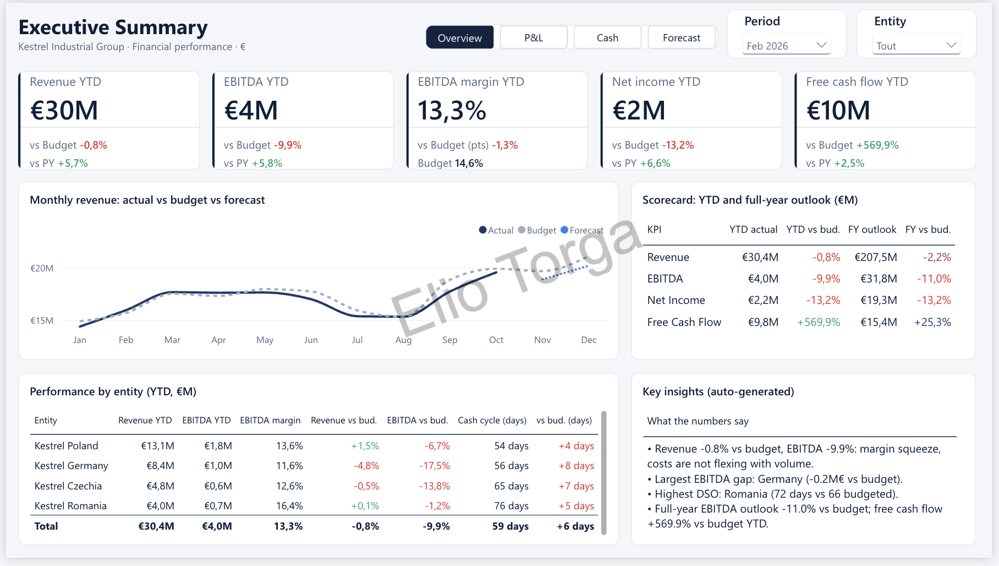
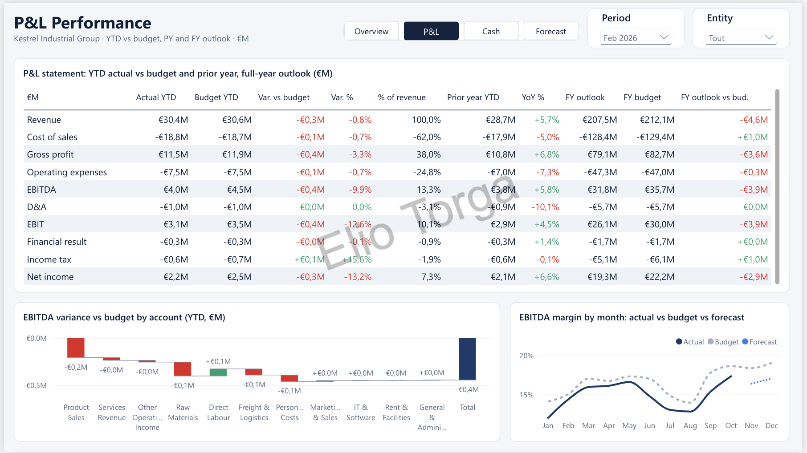
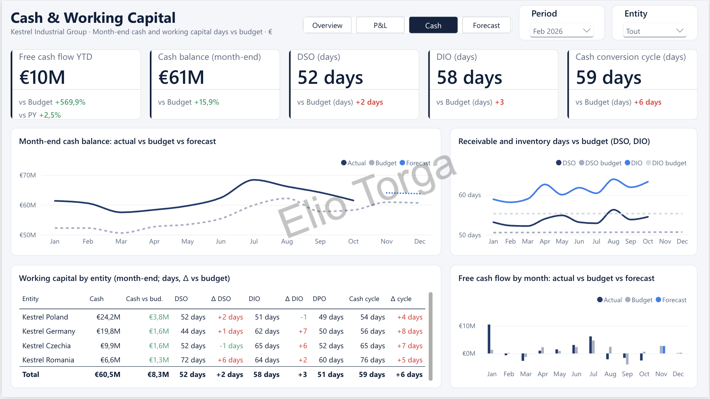
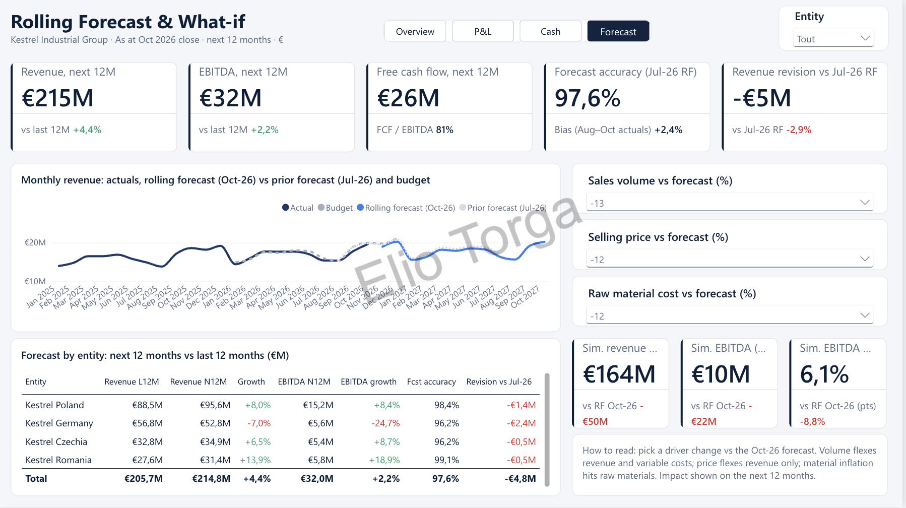
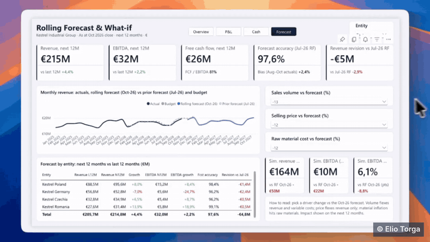
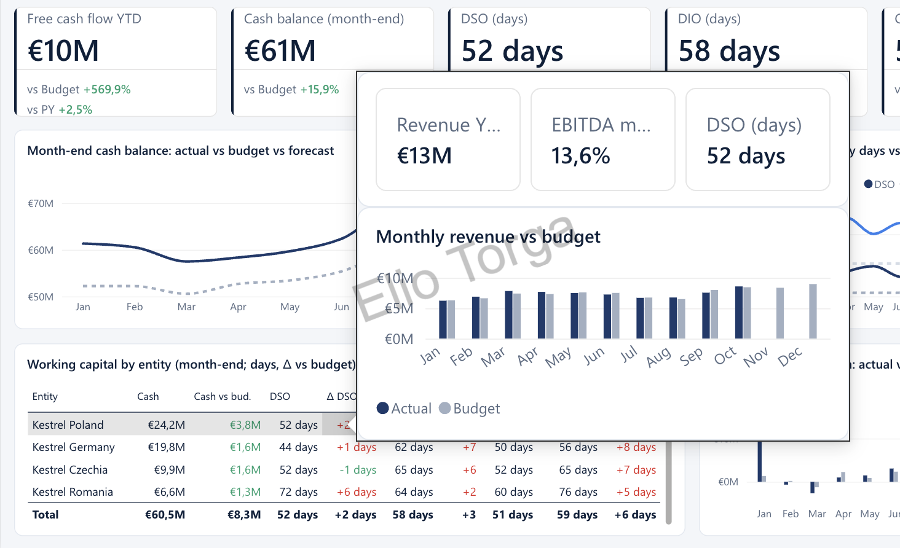

# Executive Financial Performance & Rolling Forecast – Power BI

**🇬🇧 English** · [🇫🇷 Français](README.fr.md)

A CFO-level Power BI report for a fictional industrial group operating in Central and Eastern Europe. It answers the questions a finance director asks every month: *Are we on budget? Where are we losing margin? Is cash under control? Where will we land, and what if conditions change?*




---

## Business context

**Kestrel Industrial Group** (fictional) has four subsidiaries: Poland, Germany, Czechia and Romania. The report is **as at the October 2026 close** and compares four views of the same numbers:

| Scenario | Meaning |
|---|---|
| **Actual** | Closed months, Jan 2024 – Oct 2026 |
| **Budget** | Annual plans 2024–2026, approved before each year |
| **RF Jul-26** | Rolling forecast made in July (Aug 2026 – Jul 2027) |
| **RF Oct-26** | Latest rolling forecast (Nov 2026 – Oct 2027) |

## Questions the report answers

| Question | Where |
|---|---|
| Are revenue, EBITDA, net income and free cash flow on budget and ahead of last year? | Overview |
| Which P&L lines and which entities explain the EBITDA gap? | P&L |
| Is cash under control, and are customers and stock tying up working capital? | Cash |
| Where will we land, how reliable is our forecast, and what if volume, price or material costs move? | Forecast |

## Key insights (YTD October 2026)

1. **Margin squeeze.** Revenue is only **−1.7%** vs budget (€168.4M) but EBITDA is **−10.1%** (€25.2M). The EBITDA margin is 15.0% against 16.4% budgeted: costs are not flexing with volume.
2. **Germany drives the miss.** German revenue is −6.0% vs budget and EBITDA −21.5%. Inventory days reached 78 against 55 budgeted.
3. **Cash is ahead, working capital is not.** Month-end cash is €61.5M (+5.5% vs budget), but the cash conversion cycle is 68 days (+15). Romania collects slowly: DSO is 90 days against 66.
4. **The full year will not recover.** The FY EBITDA outlook (actuals + latest forecast) is **−11.0%** vs budget.
5. **The forecast is reliable but optimistic.** The July forecast reached **97.6% accuracy** on Aug–Oct revenue, with a +2.4% optimistic bias. The October forecast cuts next-12-month revenue by about €5M (−2.9%), almost half of it in Germany.
6. **Stress test.** With volume −3%, price +2% and raw materials +5%, next-12-month EBITDA falls from about €32M to €29M and the margin from 14.9% to 13.8%.

## Report walkthrough

All pages share the same header: title, page navigator, and synced **Period** and **Entity** slicers. Green and red always mean favourable and unfavourable vs budget, including for costs and for working-capital days, where higher is worse.

### 1. Overview
KPI cards (YTD vs budget and vs prior year), revenue trend (actual / budget / forecast), a KPI scorecard, an entity table and **auto-generated key insights** written by a DAX measure.

### 2. P&L
A full P&L from revenue to net income with subtotals: Actual YTD, Budget YTD, variance, % of revenue, prior year, FY outlook and FY budget. An EBITDA variance waterfall by account and the EBITDA margin trend sit below it.



### 3. Cash & working capital
Free cash flow, cash balance, DSO, DIO and cash conversion cycle vs budget. Month-end cash trend, DSO/DIO trend, a working-capital table by entity and monthly free cash flow.



### 4. Rolling forecast & what-if
Next 12 months vs last 12 months, forecast accuracy and bias, and the revision between the July and October forecasts. The chart shows actuals, both forecasts and the budget on one timeline. Three **what-if drivers** (sales volume, selling price, raw-material cost) recalculate revenue, EBITDA and margin instantly.





### Report-page tooltip
Hovering over an entity shows a mini-dashboard with revenue, margin, DSO and monthly revenue vs budget.



## Data model


- **Star schema**: 2 fact tables (P&L flows, working-capital balances), 4 shared dimensions and 7 one-to-many relationships.
- **Signed amounts**: revenue is positive and costs are negative, so every subtotal is a plain sum.
- **Semi-additive balances**: cash, receivables, inventory and payables use the month-end value, never a sum over months.
- **Scenario dimension** with an `IsLatestForecast` flag. A new forecast version needs no DAX change.
- **Disconnected helper tables** for the P&L layout, the KPI scorecard, the trend axis and the what-if drivers.

## DAX highlights

Eight commented measures are in **[model/key-measures.md](model/key-measures.md)**:

- like-for-like budget YTD, cut at the last closed month;
- prior year with the same cut-off;
- full-year outlook (actuals + latest forecast);
- P&L built from a mapping table with `TREATAS`;
- forecast accuracy and bias;
- a what-if simulation based on cost behaviour;
- a generic KPI scorecard with colour measures;
- auto-generated executive commentary.

## Design choices

- **One question per page**, read top to bottom: headline KPIs → trend → breakdown.
- **Colour only carries meaning**: navy for actuals, grey for budget, dashed or dotted lines for forecasts, red and green only for variances.
- Numbers in **€M with one decimal**, and every variance shown both in value and in %.
- A custom JSON theme, consistent card styles, and the format painter used for identical formatting across pages.

## Tools & approach

- **Power BI Service** only, built on a Mac in the browser with no Power BI Desktop: web modelling, the TMDL view to script tables and measures, and the DAX query view to test results.
- **Python** (pandas, openpyxl) to generate a realistic synthetic dataset: seasonality, entity-specific trends, budget and two forecast versions.
- **AI-assisted development** with Claude. Every figure in this README was checked against the source data with DAX queries.

## Repository content

```
├── README.md / README.fr.md
├── screenshots/        report pages
├── demo/               what-if animation
├── model/
│   ├── star-schema.png
│   └── key-measures.md
├── data/
│   └── Kestrel_Financials_Dataset.xlsx   (synthetic)
└── theme/
    └── Kestrel_Executive_Theme.json
```

The full semantic model is not published. The selected measures above show the main logic.

## Data disclaimer

Kestrel Industrial Group is fictional. All figures are **synthetic** and generated for this portfolio project. Any resemblance to a real company is coincidental.

---

**Elio Torga** · Junior Data Analyst
[LinkedIn](https://www.linkedin.com/in/YOUR-PROFILE) · [Portfolio](https://YOUR-PORTFOLIO-URL)

© 2026 Elio Torga – all rights reserved. See [LICENSE](LICENSE).
